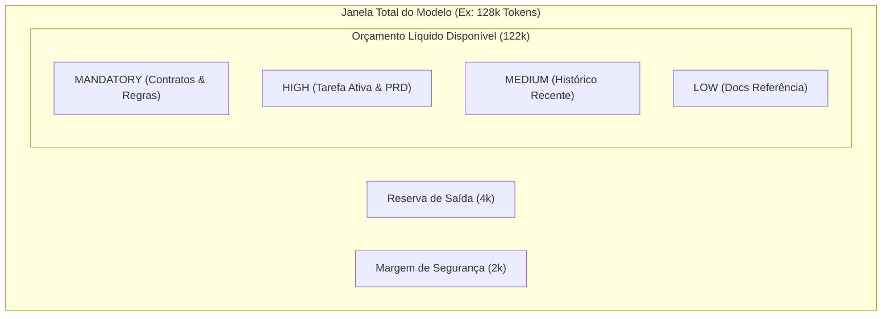
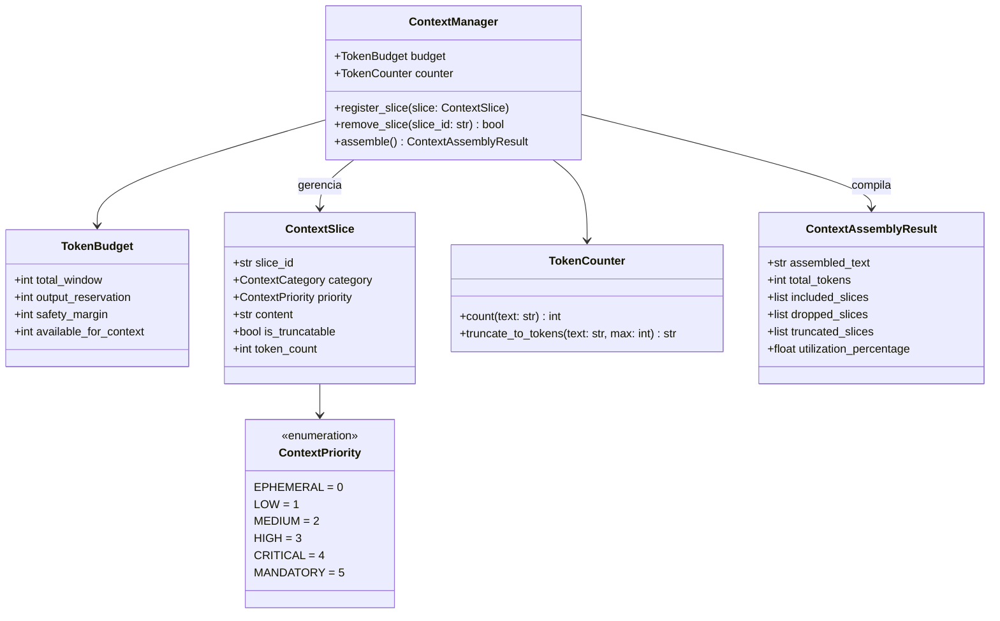

# Módulo 01: Context Engineering e Gestão da Janela de Contexto

* **Etapa:** 2 — Programa de Aprendizado em Engenharia de Sistemas Agênticos
* **Fase:** I — Engenharia de Contexto e Fundamentos Agênticos
* **Pré-requisito:** Etapa 1 (Infraestrutura de Continuidade) concluída e validada
* **Código Implementado:** `platform/src/context/`
* **Testes Validados:** `platform/tests/test_context_manager.py` (8/8 testes aprovados)

---

## 1. Objetivo de Aprendizagem

Dominar os fundamentos conceituais, matemáticos e operacionais de **Context Engineering** em Modelos de Linguagem de Grande Porte (LLMs). Compreender como gerenciar ativamente o espaço de atenção dos modelos para construir plataformas agênticas corporativas previsíveis, imunes à saturação de contexto e auditáveis.

---

## 2. Problema que este Módulo Resolve

Agentes de IA ingênuos falham no desenvolvimento de software de alta complexidade porque tratam a janela de contexto como um "repositório infinito de mensagens". As três patologias fundamentais são:
1. **Context Saturation & Decay (Degradação de Atenção):** Quanto mais texto irrelevante ou histórico antigo é colocado na janela, menor é a capacidade do modelo de atender às regras de governança e contratos críticos (*needle-in-a-haystack effect*).
2. **Explosão de Custo e Latência:** O mecanismo de auto-atenção (Self-Attention) dos Transformers tem complexidade $O(N^2)$ em computação de produto escalar entre tokens, além de custos comerciais lineares cobrados por token de entrada a cada turno.
3. **Erros de Estouro de Contexto (Context Window Overflow):** Falhas em tempo de execução quando ferramentas retornam saídas extensas sem poda prévia.

---

## 3. Explicação Teórica Aprofundada (Os 10 Aspectos Conceituais)

### 3.1. O que é Context Engineering?
Context Engineering é a disciplina de projetar, particionar, curar, priorizar e truncar determinísticamente o conjunto de tokens entregue a um LLM em cada chamada de inferência. Diferencia-se de *Prompt Engineering*:
* **Prompt Engineering:** Foca na redação e na sintaxe da instrução imediata (ex.: "Atue como arquiteto iOS e gere o seguinte contrato...").
* **Context Engineering:** Foca na arquitetura de alocação de todo o espaço disponível na janela de tokens (regras permanentes, estado atual, memória histórica, saídas de ferramentas e documentos técnicos).

### 3.2. Qual problema resolve?
Resolve o problema da atenção finita dos Transformers e a incapacidade do modelo de gerenciar autonomamente seu próprio consumo de memória de trabalho.

### 3.3. Por que existe?
Existe porque os LLMs são funções matemáticas sem estado persistente entre turnos de execução. Cada requisição reenviada à API é processada do zero. Se a aplicação externa não orquestrar o contexto, o modelo rapidamente atinge limites operacionais.

### 3.4. Como funciona internamente (A Física dos Transformers)?
O núcleo da arquitetura Transformer generativa opera sobre três matrizes para cada token:
* **Query ($Q$):** O que este token está procurando.
* **Key ($K$):** O que este token contém.
* **Value ($V$):** A informação que este token transmite.

A matriz de atenção ponderada é calculada por:
$$\text{Attention}(Q, K, V) = \text{softmax}\left(\frac{Q K^T}{\sqrt{d_k}}\right) V$$

Para uma sequência de $N$ tokens, a multiplicação $Q K^T$ gera uma matriz de dimensão $N \times N$. Consequências diretas:
* **Complexidade $O(N^2)$:** Dobrar a janela de tokens quadruplica o número de operações de produto escalar na atenção total.
* **Diluição de Atenção:** A função softmax normaliza os pesos de atenção para somar 1. Em sequências muito longas, o peso atribuído a instruções críticas no início do prompt sofre diluição (*attention diffusion*).
* **Attention Sinks:** Tokens iniciais tendem a absorver atenção espúria mesmo sem relevância semântica, exigindo delimitações formais de blocos de contexto.



### 3.5. Como se relaciona com os demais componentes?
* **Memória de Longo Prazo:** Arquivos no Git (`AGENTS.md`, `PROJECT_STATE.md`) são a fonte persistente da verdade. O Context Manager decide **quando e quanto** desses arquivos entra na janela em cada turno.
* **RAG (Retrieval-Augmented Generation):** O RAG busca fragmentos em bases vetoriais; o Context Manager valida se há orçamento disponível para recebê-los.
* **Tool Calling:** As saídas das ferramentas (ex.: compilação de código, logs de teste) passam pelo Context Manager antes de serem reinjetadas no prompt.

### 3.6. Quando deve ser utilizado?
Em todos os sistemas agênticos em produção, fluxos corporativos com múltiplos passos e tarefas de engenharia de software de longa duração.

### 3.7. Quando não deve ser utilizado?
Em consultas pontuais de turno único (single-turn Q&A) ou tarefas triviais onde o histórico total tem menos de algumas centenas de tokens.

### 3.8. Quais são suas vantagens e limitações?
* **Vantagens:** Previsibilidade financeira, ausência de falhas por estouro de contexto, foco garantido nas instruções obrigatórias e rastreabilidade total.
* **Limitações:** Risco de descartar detalhes periféricos se a política de priorização for mal calibrada.

### 3.9. Quais alternativas existem?
1. *Naive Append (Anexação Ingênua):* Concatenar todo o histórico indefinidamente. Falha inevitavelmente por estouro de janela.
2. *Blind Truncation (Janela Deslizante Ingênua):* Manter apenas os últimos $K$ turnos. Falha porque descarta as instruções iniciais e regras do sistema.
3. *Blind Summarization:* Resumir todo o histórico recursivamente. Sofre de degradação semântica (*telephone game* / perda progressiva de fatos concretos).

### 3.10. Por que escolhemos a abordagem da nossa plataforma?
Optamos por uma estratégia híbrida e determinística:
* **Fatiamento Tipado (`ContextSlice`):** Separação de conteúdo por categoria e prioridade estrita.
* **Garantia Inviolável para Contratos (`MANDATORY`):** As diretrizes de `AGENTS.md` nunca são descartadas.
* **Poda Gulosa com Truncamento Consciente:** Fatias menos críticas são podadas ou truncadas mantendo marcadores visíveis para o modelo.

---

## 4. Arquitetura da Solução Implementada

O subsistema em `platform/src/context/` organiza-se em três pilares:



---

## 5. Estrutura de Arquivos Criados no Módulo

```text
platform/
├── pyproject.toml                         # Configuração do pacote e pytest
├── src/
│   ├── __init__.py
│   └── context/
│       ├── __init__.py                    # Exportações públicas da camada de contexto
│       ├── types.py                       # Enums, Dataclasses, TokenBudget, ContextSlice
│       ├── token_counter.py               # Algoritmo de contagem e truncamento BPE
│       └── context_manager.py             # Montador determinístico e gestão de prioridades
└── tests/
    ├── __init__.py
    └── test_context_manager.py            # Suíte de 8 testes unitários automatizados
```

---

## 6. Explicação Passo a Passo do Código

### 6.1. O Modelo de Orçamento (`TokenBudget` em `types.py`)
```python
@dataclass(frozen=True)
class TokenBudget:
    total_window: int = 128_000
    output_reservation: int = 4_096
    safety_margin: int = 2_048

    @property
    def available_for_context(self) -> int:
        return self.total_window - self.output_reservation - self.safety_margin
```
*Garante que a reserva de geração (tokens de resposta do LLM) e a margem de segurança nunca sejam invadidas pelo contexto de entrada.*

### 6.2. O Algoritmo de Montagem (`assemble` em `context_manager.py`)
1. **Verificação Mandatória:** Separa fatias com `priority == MANDATORY`. Se sua soma ultrapassar `available_for_context`, dispara `ContextOverflowError` imediatamente.
2. **Ordenação Decrescente:** Ordena fatias eletivas pela prioridade numérica.
3. **Alocação por Saldo Residual:**
   * Se a fatia cabe integralmente, é incluída.
   * Se não cabe e `is_truncatable == True`, trunca o texto para caber no saldo residual (se houver pelo menos 50 tokens de saldo).
   * Se não cabe e não é truncável, registra em `dropped_slices`.

---

## 7. Evidências de Validação (Testes Automatizados)

Executado via comando:
```bash
.venv/bin/pytest platform/tests -v
```

### Saída Real do Console:
```text
============================= test session starts ==============================
platform darwin -- Python 3.13.3, pytest-9.2.0, pluggy-1.7.0
rootdir: /Users/developer/Documents/Learn/AI/AgentSystem/agent_system_for_mobile_architecture/platform
configfile: pyproject.toml
collected 8 items

platform/tests/test_context_manager.py::test_token_budget_validation PASSED [ 12%]
platform/tests/test_context_manager.py::test_token_counter_counting PASSED [ 25%]
platform/tests/test_context_manager.py::test_token_counter_truncation PASSED [ 37%]
platform/tests/test_context_manager.py::test_mandatory_slices_are_always_preserved PASSED [ 50%]
platform/tests/test_context_manager.py::test_priority_ordering_selection PASSED [ 62%]
platform/tests/test_context_manager.py::test_truncatable_slice_partial_inclusion PASSED [ 75%]
platform/tests/test_context_manager.py::test_mandatory_overflow_raises_error PASSED [ 87%]
platform/tests/test_context_manager.py::test_slice_removal_and_clear PASSED [100%]

============================== 8 passed in 0.08s ===============================
```

---

## 8. Revisão do Aprendizado e Conexão Prática

Neste módulo:
1. Compreendemos a física dos Transformers ($O(N^2)$ e diluição da atenção no softmax).
2. Diferenciamos Prompt Engineering de Context Engineering.
3. Implementamos o componente fundamental de software (`ContextManager`) que será utilizado por todos os agentes da nossa plataforma nas próximas fases.
4. Conectamos a teoria com a infraestrutura da Etapa 1: o limite de 24 KB estabelecido em `AGENTS.md` e `.agents/rules/` é precisamente uma política de Context Engineering para respeitar o orçamento de regras do Antigravity CLI.

---

## 9. Próximo Passo

O **Módulo 01** está totalmente implementado, documentado e testado.
Aguardando sua autorização para avançar para o **Módulo 02: Fundamentos de LLMs, Modelos Google e Function Calling**.
