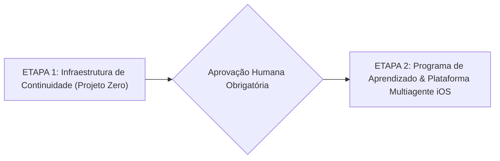

# PLANEJAMENTO MACRO E CRONOGRAMA TÉCNICO (ROADMAP)

Este documento define o planejamento em fases da plataforma agêntica corporativa para desenvolvimento mobile iOS e do programa de aprendizado.

---

## Estrutura Sequencial Geral

---

## ETAPA 1: INFRAESTRUTURA DE CONTINUIDADE (PROJETO ZERO)
**Status:** EM ANDAMENTO  
**Meta:** Estabelecer a infraestrutura de gerenciamento de contexto, persistência, recuperação de sessões e governança Git antes de iniciar qualquer módulo do curso.

* [x] **Marco 1.1:** Planejamento Geral e Arquitetura aprovados pelo usuário.
* [ ] **Marco 1.2:** Estruturação da topologia de diretórios e contratos operacionais (`AGENTS.md`, `state/`, `sessions/`, `.agents/`).
* [ ] **Marco 1.3:** Integração nativa com Google Antigravity CLI (Rules, Skills, Hooks).
* [ ] **Marco 1.4:** Teste experimental de estresse e recuperação de sessão (atendimento aos 14 critérios de aceitação).
* [ ] **Marco 1.5:** Aprovação formal da Etapa 1 pelo usuário.

---

## ETAPA 2: PROGRAMA DE APRENDIZADO E PLATAFORMA MULTIAGENTE IOS
**Status:** BLOQUEADA (Aguardando aprovação da Etapa 1)  
**Meta:** Construção cumulativa e prática da plataforma agêntica corporativa para engenharia de software iOS nativo.

### FASE I: Engenharia de Contexto e Fundamentos Agênticos
* **Módulo 01:** Context Engineering e Gestão da Janela de Contexto
* **Módulo 02:** Fundamentos de LLMs, Modelos Google e Function Calling
* **Módulo 03:** Engenharia de Prompts Estruturada e Metaprompting
* **Módulo 04:** Fundamentos de Agentes e o Loop Percepção-Ação (ReAct puro)

### FASE II: Ferramentas, Protocolos e Memória Externa
* **Módulo 05:** Tool Engineering, Sandboxing e Validação de Contratos
* **Módulo 06:** Model Context Protocol (MCP) e Integrações Corporativas
* **Módulo 07:** Arquitetura de Memória e RAG Especializado em Documentação Apple

### FASE III: Orquestração Avançada com LangGraph e Sistemas Multiagentes
* **Módulo 08:** Orquestração com LangGraph: Nós, Arestas e Estados Cíclicos
* **Módulo 09:** LangGraph Avançado: Checkpoints, Time-Travel e Human-in-the-Loop
* **Módulo 10:** Sistemas Multiagentes: Topologias, Delegação e Handoffs

### FASE IV: Harness Engineering, Observabilidade e Evals
* **Módulo 11:** Harness Engineering e Contenção Operacional
* **Módulo 12:** Observabilidade e Tracing com LangSmith
* **Módulo 13:** Evals Automatizados e LLM-as-a-Judge

### FASE V: Execução Concorrente, Git Worktree e Governança Empresarial
* **Módulo 14:** Git Agent e Automação de Git Worktrees
* **Módulo 15:** Governança Corporativa, Matriz de Permissões e Prompt Defense
* **Módulo 16:** Orquestração Concorrente de Agentes e Mediação de Conflitos

### FASE VI: A Plataforma Completa de Engenharia Mobile iOS
* **Módulo 17:** Pipeline SDLC de Engenharia de Software Mobile (Swift, Xcodebuild, Lint)
* **Módulo 18:** Construção Autônoma do Aplicativo Financeiro iOS (Projeto Final Completo)
